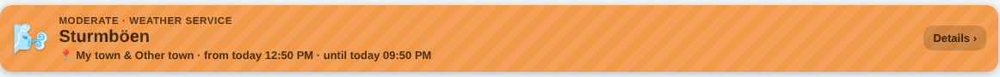

# NINA Warning Card

Shows official warnings from the **NINA** integration (German federal warning app: weather service, civil protection, flood centres) for several places at once.



- The same warning for several places is shown **once**, with all affected places.
- Colour by severity (minor, moderate, severe, extreme), icon by type (storm, thunderstorm, ice, frost, snow, rain, heat, fog, flood, fire).
- Start and end in plain words (“today 18:00”, “tomorrow 06:00”), link to details.
- Hides itself when there is nothing to warn about (or shows a calm line with `show_empty: true`).
- English and German texts, following the user's language.

## Installation

**HACS (recommended):** open HACS, search for **NINA Warning Card**, install it and reload the browser.

If it does not show up yet: HACS → ⋮ → *Custom repositories* → add this repository with type *Dashboard* → install → reload the browser.

**Manual:** copy `nina-warning-card.js` to `config/www/` and add `/local/nina-warning-card.js` as a JavaScript module resource.

Set up the [NINA integration](https://www.home-assistant.io/integrations/nina/) for each place first.

## Options

| Option | Description |
|---|---|
| `places` | List of `{name, prefix, slots}` (required). `prefix` is the part of the entity IDs between `binary_sensor.warning_` and `_1`. `slots` = number of warning slots (default 5) |
| `show_empty` | Show a line when there are no warnings (default: card is hidden) |
| `keys` | Override the sensor suffixes if your entity IDs differ, e.g. `{head: headline, end: expires}` |

The card reads the details from the NINA sensors (`sensor.<prefix>_headline_1`, …) in German or English installations, and falls back to attributes on the binary sensor.

```yaml
type: custom:nina-warning-card
places:
  - name: Hometown
    prefix: hometown_district
  - name: Work
    prefix: city_of_work
```

Tip: put the card at the top of a dashboard and make it visible only while a warning is active, e.g. with a template binary sensor that combines all `binary_sensor.warning_*`.

## Deutsch

Amtliche Warnungen aus der NINA-Integration für mehrere Orte zusammengefasst: gleiche Warnung nur einmal mit allen Orten, Farbe nach Schweregrad, Symbol nach Art, Zeiten in Klartext. Ohne Warnung blendet sich die Karte aus.

## License

MIT – see [LICENSE](LICENSE).
